# Index des images de `art_src`

Tout ce que la chaîne pixel art a produit, par catégorie, avec une vignette de chaque image. **Ce fichier est écrit par un outil** : on ne le retouche pas à la main. Après avoir ajouté, renommé ou retiré une image, on le régénère depuis `art_src/tools/` :

`python index_art.py`

| Catégorie | Dossier | Ce que c'est | Images |
|:---|:---|:---|:---|
| [Sprites](#sprites) | `sprites/<famille>/tier_<n>/` | Une créature détourée, en 128 × 192, avec son aperçu sur un fond de fenêtre | 3 |
| [Fonds de fenêtre](#fonds-de-fenêtre) | `fonds/<lieu>/` | L'image derrière une créature, dans la fenêtre de son cadre, en 128 × 192 | 3 |
| [Décors d'écran](#décors-décran) | `decors/<lieu>/<écran>/` | L'image derrière tout un écran, en 640 × 360 | 3 |
| [Décors de la première méthode](#décors-de-la-première-méthode) | `decors/anciens_320x180/<thème>/` | Trois décors en 320 × 180, gardés à part : aucun n'est repris tel quel | 3 |
| [Cadres](#cadres) | `cadres/` | Le cadre d'un tier d'ennemi, autour de la fenêtre | 1 |

Chaque image livrable est un `.aseprite`. À côté d'elle, dans son dossier : ses images sources, ses guides, et son brief quand elle en a un. Les versions remplacées sont dans [`archives/`](archives/README.md) ; les méthodes, dans [`docs/`](docs/) ; les outils et leurs commandes, dans [`tools/`](tools/README.md).

## Sprites

La première vignette est le sprite seul ; les suivantes, ses aperçus sur un fond de fenêtre. Méthode : [le workflow des créatures](docs/workflow_creature.md).

| Aperçu | Nom | Famille · tier | Taille | Fichier | État |
|:---|:---|:---|:---|:---|:---|
| 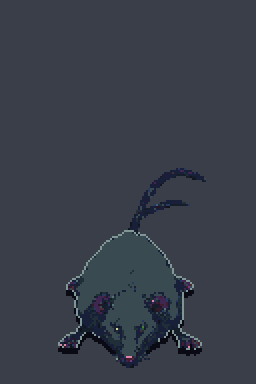 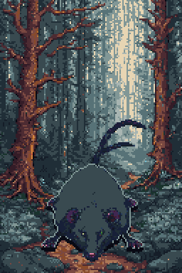 | **rat_geant** | rat · tier 1 | 128 × 192 · 7 calques | `sprites/rat/tier_1/rat_geant.aseprite` | sprite livré le 14/11/2026, à 80 % de sa taille de génération, pattes arrière et liseré posés — brief validé le 13/11/2026. **Figure retenue :** l'essai de l'audit sur la graine 471738 (guide lâche, prompt corrigé), auquel le propriétaire a fait ajouter les pattes arrière (tour 11), puis qu'il a fait réduire à 80 % (tour 12), la taille qu'il juge parfaite devant les fonds. Il a laissé à l'agent les décisions de la fin de chaîne (ombre, rose, pelage, calques). **Reste :** la retouche à la main (étape 9) — [brief](sprites/rat/tier_1/rat_geant_brief.md) |
|  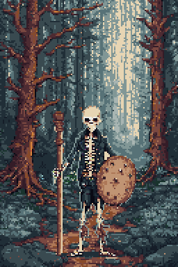 | **squelette** | squelette · tier 2 | 128 × 192 · 6 calques | `sprites/squelette/tier_2/squelette.aseprite` | — |
| 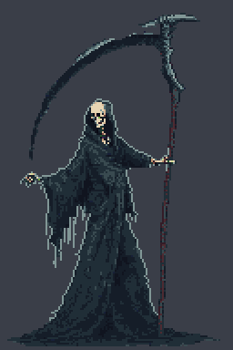 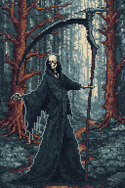 | **squelette_faucheuse** | squelette · tier 3 | 128 × 192 · 5 calques | `sprites/squelette/tier_3/squelette_faucheuse.aseprite` | — |

## Fonds de fenêtre

Méthode : [le workflow des fonds de fenêtre](docs/workflow_fond.md).

| Aperçu | Nom | Lieu | Taille | Fichier | État |
|:---|:---|:---|:---|:---|:---|
| 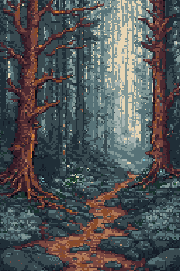 | **forest_window_1** | forest | 128 × 192 · 1 calque | `fonds/forest/forest_window_1.aseprite` | — |
| 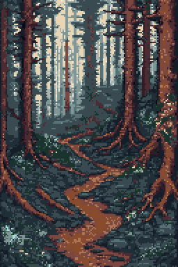 | **forest_window_2** | forest | 128 × 192 · 1 calque | `fonds/forest/forest_window_2.aseprite` | — |
| 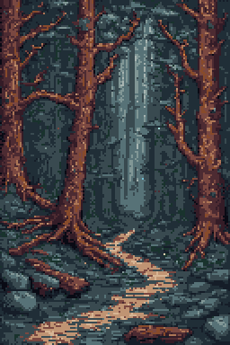 | **forest_window_3** | forest | 128 × 192 · 1 calque | `fonds/forest/forest_window_3.aseprite` | — |

## Décors d'écran

Méthode : [le workflow des décors](docs/workflow_decor.md).

| Aperçu | Nom | Lieu · écran | Taille | Fichier | État |
|:---|:---|:---|:---|:---|:---|
| 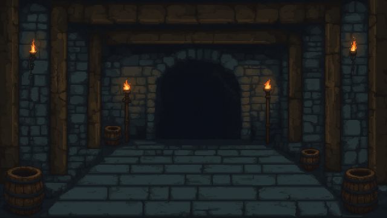 | **dungeon_combat** | dungeon · combat | 640 × 360 · 1 calque | `decors/dungeon/combat/dungeon_combat_detail.aseprite` | décor validé le 24/11/2026 — [brief](decors/dungeon/combat/dungeon_combat_brief.md) |
| 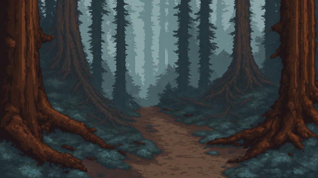 | **forest_combat** | forest · combat | 640 × 360 · 1 calque | `decors/forest/combat/forest_combat_detail.aseprite` | décor validé le 24/11/2026 — [brief](decors/forest/combat/forest_combat_brief.md) |
| 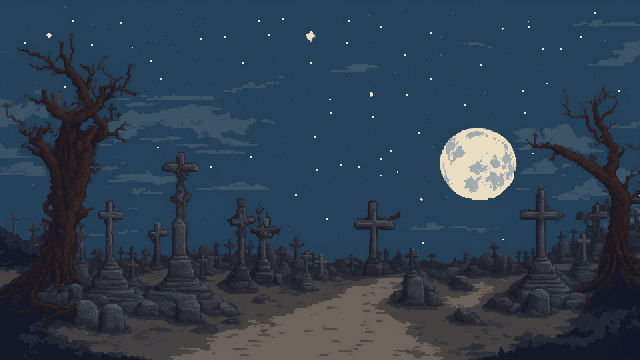 | **graveyard_combat** | graveyard · combat | 640 × 360 · 1 calque | `decors/graveyard/combat/graveyard_combat_detail.aseprite` | décor validé le 24/11/2026, dans sa seconde version : le dernier pas refait à 0.5, après l'analyse de la première — [brief](decors/graveyard/combat/graveyard_combat_brief.md) |

## Décors de la première méthode

En 320 × 180, par la structure en calques et une seule génération. Chaque dossier porte aussi `<nom>.aseprite`, la structure rendue par le code, et ses cartes de guidage.

| Aperçu | Nom | Thème | Taille | Fichier | État |
|:---|:---|:---|:---|:---|:---|
| 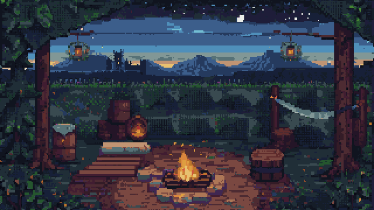 | **forest_camp** | camp | 320 × 180 · 15 calques | `decors/anciens_320x180/camp/forest_camp_detail.aseprite` | — |
| 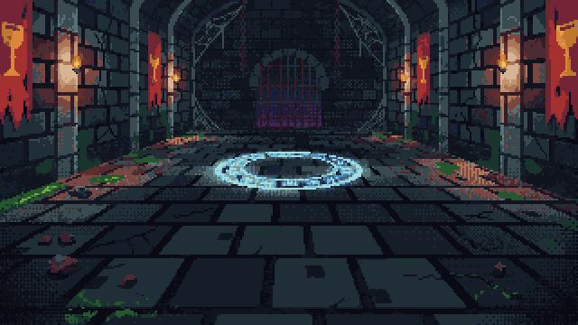 | **dungeon_hall** | dungeon | 320 × 180 · 9 calques | `decors/anciens_320x180/dungeon/dungeon_hall_detail.aseprite` | — |
| 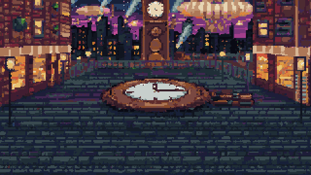 | **clockwork_plaza** | steampunk | 320 × 180 · 14 calques | `decors/anciens_320x180/steampunk/clockwork_plaza_detail.aseprite` | — |

## Cadres

| Aperçu | Nom | Taille | Fichier | État |
|:---|:---|:---|:---|:---|
| 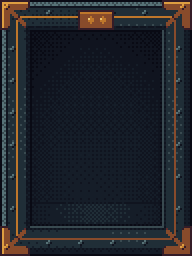 | **tier_2** | 96 × 128 · 6 calques | `cadres/tier_2.aseprite` | — |
